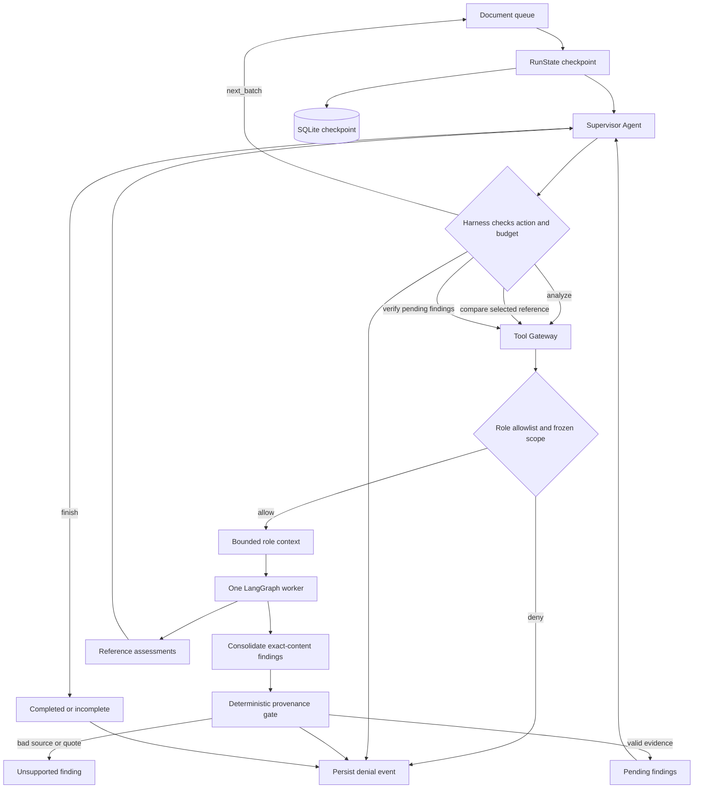

# Paper Review harness

## Harness capabilities

| Capability | Implementation | Visible trace |
| --- | --- | --- |
| Loop | Supervisor action per turn, 20 document batches and 80 turns by default | Decision, batch selection, budget exhausted |
| Tool | `read_chunks`, `search_reference`, `read_rubric` | Tool name, safe source IDs and result |
| Memory | Versioned `RunState` persisted after each turn | Checkpoint event, processed and remaining counts |
| Context | Constructed from permitted tool results, selected rubric and public progress | Context event and included source IDs |
| Permission | Agent allowlist and frozen paper/version scope before data is returned | Allow or deny result |
| Output control | Strict schemas, source identity/version, exact nonempty quote, resolved locator and comparison coverage | Per-finding validation result and reason codes |
| Agent activation | One worker per supervisor turn; comparator only for selected papers; verifier only for pending evidence | Call counts and `agent_skipped` events |
| Finding consolidation | Same criterion, kind, compared-paper set and normalized claim; union provenance-valid evidence under the first canonical ID | `findings_merged`, canonical/merged IDs, added evidence and verification state |

Supervisor is the control agent; the other three are subagents called through the harness. A worker never receives a Groq key, opens a file, or runs a tool directly. In fixture mode, generated output is clearly labeled as a workflow example. In Groq mode, provider JSON structure is checked locally and source provenance is checked independently; a valid quote still does not prove scientific correctness.

For PDF, a locator is a one-based page. For DOCX, it is a one-based nonempty paragraph index. MarkItDown supplies Markdown for model context; independent original-file extraction anchors citations. If conversion text does not map uniquely, the locator stays unresolved and the output gate prevents it from being marked supported.

The run inspector renders persisted events; its diagram reflects actual call counts. It does not invent intermediate agent activity. Failed runs can be inspected, while interrupted runs can be explicitly resumed from their saved state.

Provider recovery distinguishes timeout, connection, authentication, missing model,
invalid request and temporary HTTP failures. Timeout/connection/408/409/5xx may
retry twice per structured generation with 2/4-second backoff, respecting numeric
or HTTP-date Retry-After. A delay above 30 seconds stops inline recovery; the run
retains its checkpoint for explicit resume. Quota handling remains separate and
can add its own wait. Cancellation is checked during backoff. Trace records only
safe failure type, status, request ID and retry decision, never raw response
bodies, prompts or credentials. Legacy provider_unavailable traces cannot reveal
the historical upstream cause that the old adapter discarded.

## Consolidation before verification

The harness consolidates drafts before adding verification or repair work. Claim
identity uses NFC Unicode normalization, case folding and whitespace collapse;
punctuation, numbers, negation and accents remain significant. Criterion codes,
finding kinds and sets of compared paper IDs must match exactly. Paraphrases and
translations are deliberately not merged, and this step makes no model calls.

The first finding keeps its ID and wording. Only source references passing the
provenance gate enter the evidence union; comparison findings still require both
sides before reaching Evidence Verifier. Duplicate source references, including
extraction whitespace differences in legacy quotes, do not reopen a final verdict.
New valid evidence clears the old verdict and queues the canonical claim for fresh
semantic verification. Restored mixed-quality source lists are sanitized before
verification. Partial valid comparison sources can accumulate while the finding
remains unsupported, rather than being discarded.

Pending queues are consolidated again before verification, covering checkpoint
resume and repaired drafts. Duplicate repair jobs share the canonical ID and the
existing bounded repair attempt; a repair matching another verified claim can skip
verification. Omission topics are grouped without resetting full-paper audit
progress. Merge decisions appear in the normal trace and the resulting lists are
saved through the existing checkpoint. No completed historical reviews are migrated.

Consolidation reduces repeated claims and verification input size. It reduces the
number of verifier calls when a repeated claim has no new evidence; claims that
gain genuinely new sources are verified again, so call savings depend on the run.

## Continuing an unfinished turn after quota cooldown

`RunState.turn_progress` stores the accepted Supervisor action, prepared worker
context and any successfully received worker output for one unfinished turn.
After a worker hits a quota limit, the background worker persists the latest safe
checkpoint and cooldown deadline, instead of discarding the Supervisor decision.
The next tick restores that action, rechecks scheduling eligibility, and retries
only the unfinished worker. A retry remains in the same logical turn, including
when that turn reached the configured turn budget.

The saved domain state stays at the pre-worker boundary: a throttled repair does
not lose its queue entry or spend a repair attempt, an omission audit does not
advance its cursor, and an analysis does not duplicate findings or coverage.
Actual worker-call counters still include retried calls. Prepared context is
reused only while source permissions, versions and content still match; ordinary
output validation remains mandatory. Successfully received structured output can
be reused during replay without a second model call. Progress is cleared only
when the action completes or the scheduling guard rejects it.

Trace events `decision_reused`, `context_reused` and `worker_output_reused` expose
reuse. `provider_cooldown` includes `resume_action`. Old checkpoints without
`turn_progress` continue normally. SQLite receives the intermediate checkpoint at
the tick's persistence boundary, including quota/failure exits; model calls do not
hold a SQLite write transaction. A hard process crash before that boundary, or a
provider response lost before reception, cannot guarantee exactly-once model calls.

## Actual work progress in the run inspector

GET `/api/v1/runs/{id}` includes a safe `activity` projection: current phase,
agent, resume action, optional retry deadline, and measured work counts. While a
single local worker is inside a provider call, event callbacks publish thread-safe
in-process metadata so HTTP readers do not have to wait for the tick to finish.
No document text, model context or raw output is included in this projection.
Live metadata is cleared on every tick exit. Lifecycle states and future persisted
cooldowns override live data; after a cooldown expires, an actual resumed worker
can replace the stale waiting phase. Checkpoint data is the fallback after restart
or between ticks. This live channel assumes the existing single-process backend;
multiple API processes would need a shared activity store.

The UI names planning, analysis, comparison, verification, repair, omission audit,
finalization and quota waits. The progress bar measures main-paper reading only;
reading all chunks does not imply completion of verification or the whole review.
Separate counters show pending verification/repairs, executed repair attempts,
processed references and checked chunks for the current omission-topic group.
The interface shows whether data is live or checkpoint-based and reports polling
freshness/connection failures. Countdown means the next retry time, never an ETA
for the complete review. Navigation stays available throughout.

## Work sized by request tokens

Source pages/paragraphs remain immutable coverage and location records. Before a
Groq worker call, the runtime planner checks the exact role prompt, context and
JSON schema with the same UTF-8 token estimator used by the adapter. It reserves
the configured full completion budget plus 256 tokens for framing/schema-repair
headroom against the configured per-model token window. Estimates are heuristic;
provider 429 handling remains necessary.

Long producer inputs are partitioned and greedily packed using original span IDs.
No chunk is replaced or renumbered; the evidence resolver still derives exact
quotes and absolute Unicode character offsets from the original chunk. Comparison
work keeps both main and related sources, reusing an anchor when needed. Retrieval
scope itself is unchanged by partitioning.

Verification is packed by finding groups with all cited spans and nearby context,
not all full source pages. When necessary, nearby context is reduced before any
cited passage; cited evidence is never discarded to manufacture a fit.
When a single finding has too many citations, its evidence is partitioned too,
preserving both sides in every comparison assessment. The original finding keeps
all of its evidence; inconsistent subset assessments produce uncertainty rather
than a supported claim.
Omission audits group topics against every assigned source span and overlap boundary spans
when capacity permits. Presence in any window refutes absence. Missing/ambiguous
assessments, or a budget too small to retain boundary context, produce uncertainty
rather than a whole-document absence claim.

`TurnProgress.work_contexts` and `work_outputs` retain completed subcalls. Quota
resume starts at the unfinished subcall without a new Supervisor decision. Domain
findings and page coverage are advanced only after the work is combined. These
fields use the existing tick-boundary persistence guarantees described above.
The inspector exposes completed/total subtask counts through metadata, with
`token_work_planned`, `token_work_started` and `token_work_completed` trace events.

An indivisible claim or fixed rubric/prompt/schema that cannot fit even with the
minimum source unit fails with `token_work_item_too_large`. It is not treated as a
temporary quota shortage and is not retried indefinitely. Large metadata is not
silently truncated. In-flight cached work assumes unchanged prompt/model/budget
configuration; changing those during a paused run may require a new revision.
